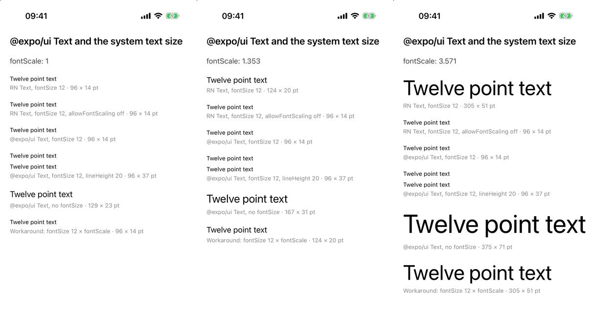
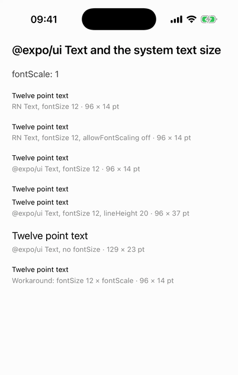
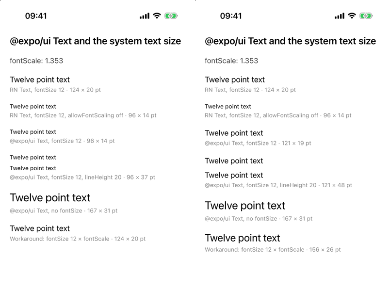
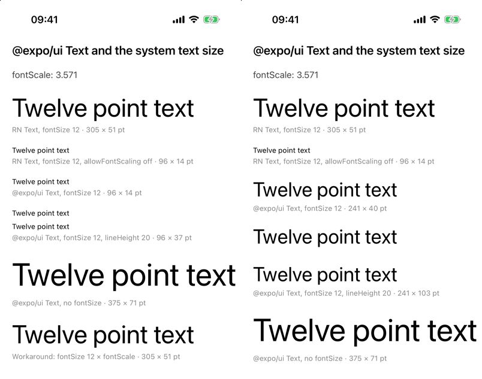
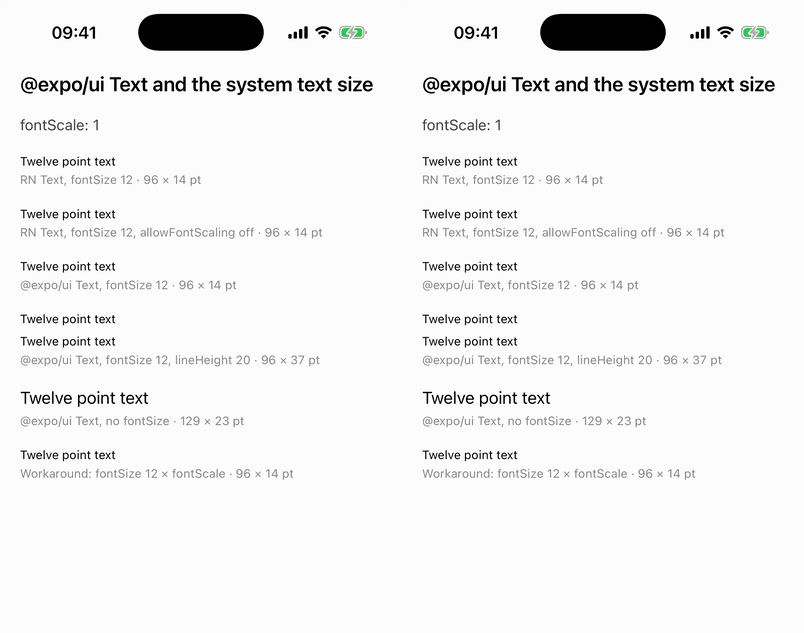

# @expo/ui Text ignores the system text size when textStyle.fontSize is set (iOS)

Reproduction for https://github.com/expo/expo/issues/54006 on iOS, with every row measured on
screen so the numbers can be read from the screenshots.

Versions: Expo SDK 58 (`expo` 58.0.26), `@expo/ui` 58.0.29, `expo-modules-core` 58.1.0,
`react-native` 0.88.1, New Architecture.
Recorded on the iPhone 17 Pro simulator, iOS 26.5, Xcode 27.2, 11/23/26.

## Run

```sh
npm install
npx expo run:ios   # development build, iOS simulator or device
```

Then change the system text size while the app is open. On a simulator:

```sh
xcrun simctl ui booted content_size extra-extra-extra-large
xcrun simctl ui booted content_size accessibility-extra-extra-extra-large
xcrun simctl ui booted content_size large   # back to the default
```

On a device: Settings > Accessibility > Display & Text Size > Larger Text.

## What the screen shows

The `fontScale` reported by `useWindowDimensions()`, then six rows with the same string. Under
each row a fixed-size caption prints the row's `onLayout` width and height in points.

| Row | Component | Expected on a larger text size |
| --- | --- | --- |
| RN Text, fontSize 12 | React Native `Text`, `style={{ fontSize: 12 }}` | Grows by `fontScale` (`allowFontScaling` default) |
| RN Text, fontSize 12, allowFontScaling off | React Native `Text` with `allowFontScaling={false}` | Stays 12 pt, the opt-out |
| @expo/ui Text, fontSize 12 | `@expo/ui` `Text`, `textStyle={{ fontSize: 12 }}` | Grows like the first row |
| @expo/ui Text, fontSize 12, lineHeight 20 | same, two lines, `lineHeight: 20` | Grows, line spacing included |
| @expo/ui Text, no fontSize | `@expo/ui` `Text` with no `textStyle` | Grows (SwiftUI body style) |
| Workaround: fontSize 12 × fontScale | `textStyle={{ fontSize: 12 * fontScale }}` | Grows |

## Result

Measured `width × height` in points from `media/bug-text-size-<step>.png`, one text size per
column. The text size was changed with `xcrun simctl ui` while the app stayed open; the app
re-rendered on each change and `fontScale` updated.

| Row | large (1) | extra-large (1.118) | XXX-large (1.353) | AX medium (1.786) | AX XXX-large (3.571) |
| --- | --- | --- | --- | --- | --- |
| RN Text, fontSize 12 | 96 × 14 | 106 × 16 | 124 × 20 | 156 × 26 | 305 × 51 |
| RN Text, fontSize 12, allowFontScaling off | 96 × 14 | 96 × 14 | 96 × 14 | 96 × 14 | 96 × 14 |
| **@expo/ui Text, fontSize 12** | 96 × 14 | **96 × 14** | **96 × 14** | **96 × 14** | **96 × 14** |
| **@expo/ui Text, fontSize 12, lineHeight 20** | 96 × 37 | **96 × 37** | **96 × 37** | **96 × 37** | **96 × 37** |
| @expo/ui Text, no fontSize | 129 × 23 | 143 × 25 | 167 × 31 | 202 × 37 | 375 × 71 |
| Workaround: fontSize 12 × fontScale | 96 × 14 | 106 × 16 | 124 × 20 | 156 × 26 | 305 × 51 |

The two `@expo/ui` rows with a `fontSize` never change. They match the React Native row that
opted out of font scaling, not the default React Native row. The `@expo/ui` row with no
`fontSize` scales, so Dynamic Type reaches the view; only the fixed size ignores it.

Step log with timestamps: `media/bug-text-size.txt`.

### With the fix

The same sweep on the same app with the change from the fix PR applied to
`node_modules/@expo/ui` (the Swift sources under `ios/` and the compiled JavaScript under
`build/`). Measured from `media/fixed-text-size-<step>.png`.

| Row | large (1) | extra-large (1.118) | XXX-large (1.353) | AX medium (1.786) | AX XXX-large (3.571) |
| --- | --- | --- | --- | --- | --- |
| RN Text, fontSize 12 | 96 × 14 | 106 × 16 | 124 × 20 | 156 × 26 | 305 × 51 |
| RN Text, fontSize 12, allowFontScaling off | 96 × 14 | 96 × 14 | 96 × 14 | 96 × 14 | 96 × 14 |
| **@expo/ui Text, fontSize 12** | 96 × 14 | **103 × 16** | **121 × 19** | **141 × 22** | **241 × 40** |
| **@expo/ui Text, fontSize 12, lineHeight 20** | 96 × 37 | **103 × 40** | **121 × 48** | **141 × 57** | **241 × 103** |
| @expo/ui Text, no fontSize | 129 × 23 | 143 × 25 | 167 × 31 | 202 × 37 | 375 × 71 |
| Workaround: fontSize 12 × fontScale | 96 × 14 | 114 × 18 | 156 × 26 | 237 × 40 | 842 × 144 |

Both `@expo/ui` rows with a `fontSize` now grow with the text size, and the line spacing grows
with the font. They scale by the SwiftUI body metrics, like the row with no `fontSize`, so at the
accessibility sizes they are a little smaller than the React Native row, which uses React
Native's own multipliers. The workaround row scales twice with the fix, once in JavaScript and
once by Dynamic Type, so drop the workaround when the fix ships.

Step log: `media/fixed-text-size.txt`.

## Media

Default text size on the left, XXX-large in the middle, accessibility XXX-large on the right:





Published package on the left, fixed on the right, at XXX-large and at accessibility XXX-large:







Fixed run recording: `media/fixed-text-size.mp4`, screenshots `media/fixed-text-size-<step>.png`.

Screen recording: `media/bug-text-size.mp4`.
Per-step screenshots: `media/bug-text-size-0-large.png` through `media/bug-text-size-5-back-to-large.png`.
Simulator and toolchain details: `media/simulator-ios-version.txt`.

## Cause

`src/universal/Text/index.ios.tsx` turns `textStyle.fontSize` into the `font({ size })` modifier
and `textStyle.lineHeight` into `lineSpacing(lineHeight - fontSize)`. In
`ios/Modifiers/FontModifier.swift`, `resolveBaseFont` handles a size with no `family` and no
`textStyle` by returning `.system(size:weight:design:)`. That is a fixed-size SwiftUI font, which
Dynamic Type does not scale. The other branches use `relativeTo:` or a text style, which is why
the row with no `fontSize` grows. The line spacing is a fixed number of points for the same
reason.

React Native's `Text` multiplies both `fontSize` and `lineHeight` by the current `fontScale`
unless `allowFontScaling={false}` is set, so the same style scales in one component and not in
the other. Android's `TextView.kt` passes the values to Compose in `sp`, which scale, so the
mismatch is iOS only.

## Fix

https://github.com/expo/expo/pull/54011 scales a `font` modifier `size` relative to its `textStyle`
for the system font with `UIFontMetrics` and the SwiftUI `dynamicTypeSize` environment, lets
`lineSpacing` scale the same way, and has the universal `Text` pass `textStyle: 'body'` for its
`fontSize`, `fontWeight` and `lineHeight`. The "With the fix" table above was recorded with that
change applied.

## Workaround

Scale the size in JavaScript with the `fontScale` from `useWindowDimensions()`, which is what the
last row does:

```tsx
const { fontScale } = useWindowDimensions();

<Host matchContents>
  <ExpoUIText textStyle={{ fontSize: 12 * fontScale, lineHeight: 20 * fontScale }}>
    Twelve point text
  </ExpoUIText>
</Host>
```

The hook re-renders when the text size changes, so the row follows the setting live. It does not
pick up `maxFontSizeMultiplier`, and it has to be repeated at every call site.
